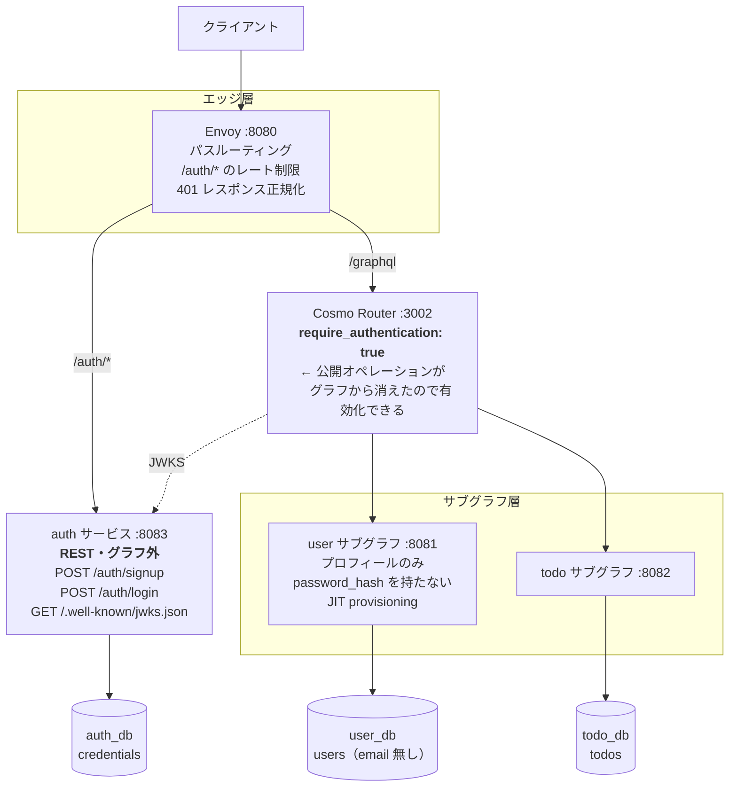

# ADR 0001: 認証を user サブグラフから分離するか

- ステータス: **Accepted**
- 提案日: 2026-09-13
- 決定日: 2026-09-13
- 決定: **案 1（専用 Auth サービスをグラフの外に出す + JIT provisioning）を採用**
- 関連: [design.md](../design.md) §3, §4, §5, §6, §8, [todo.md](../../todo.md) #1, #2

> **決定の記録**
> 初版の設計（案 D: user サブグラフ内に認証を同居）でレビューに入ったところ、
> 「認証は別サービスにすべきではないか」という指摘があり、本 ADR で調査・比較した。
> 決め手となったのは §1.3-理由 3 / §2.2-D1 で、**認証がグラフの中にある限り
> `authorization.require_authentication: true` が使えず、設計がフェイルオープンに
> なる**という構造的な問題だった。これは実装時の注意深さでは解消できない。
> 案 3（外部マネージド IdP）は最も本番的だが、自作 JWT の学習価値を失うため今回は見送り、
> 案 1 の構造（グラフ外 IdP + JIT provisioning）にしておくことで、
> 将来 Cognito 等へ移行する際のコストを設定変更レベルまで下げることを狙う。
> 本決定に伴い design.md の §2〜§12 を全面改訂した（移行ステップは §6 参照）。

---

## 背景

[design.md](../design.md) の初版では、認証（signUp / login / JWT 発行 / JWKS 配信）を
**user サブグラフの中**に置いた。実装に入る前に「認証は独立したサービスにすべきでは」
という再検討が入ったため、業界の一般的な構成を調査し、現構成の得失を整理して
改善案を提示する。

---

> **注記**: 以降の本文で参照している design.md の節番号は、**この ADR を書いた
> 時点（改訂前）のもの**。決定の採用に伴い design.md は全面改訂され、節番号がずれている。
> ADR は決定時点のスナップショットとして残す方針のため、本文の番号は更新しない。
> 現在の対応は次のとおり: 旧 §6.3（Router 設定）→ 現 §6.5、旧 §6.4（サブグラフ再検証）→ 現 §6.6、
> 旧 §6.5（実装ルール）→ 現 §6.7、旧 §6.6（認可ポリシー表）→ 現 §6.8。

## 1. 調査: Federation 構成における認証の一般的な配置

### 1.1 業界のコンセンサス

複数の一次情報（Apollo、Grafbase、Hive Gateway、Cosmo、microservices.io）で一致していたのは
次の 3 点だった。

**(a) 認証はゲートウェイで 1 回だけ行い、claims をヘッダで下流に渡す。**
「supergraph で一度認証し、user ID / claims / roles を信頼されたヘッダとして
サブグラフに転送する」のが推奨パターン。これは現設計 §6.3 と一致しており、
ここは変更不要。

**(b) 認可はゲートウェイとアプリで役割を分ける。**
ゲートウェイは coarse-grained（そもそも API を呼べるか）、アプリケーションは
fine-grained（このフィールド・このレコードを見せてよいか）。
Router はサブグラフのドメイン知識を持たないため、Router だけで認可を完結させようとすると
破綻する。これも現設計 §6.4〜6.5 の方針（多層防御）と一致。

**(c) トークンの発行元は「グラフの外の専用サービス」であることが圧倒的に多い。**
集中管理された認証サービスがユーザー識別の単一の真実源となり、管理が単純になるうえ
**攻撃面が有意に小さくなる**、というのが共通した論拠。Keycloak / Auth0 のような
IdP が JWT を発行し、各 GraphQL サービスは独立に検証する。

補強材料として、**Cosmo プラットフォーム自身のリファレンスアーキテクチャが
Keycloak を独立コンポーネントとして持っている**。Router / Controlplane / Studio とは
別のコンポーネントで、OIDC・SCIM で外部 IdP と連携する構造になっている。
Federation 基盤を作っている当事者が、認証をグラフの外に置いている。

### 1.2 実際に見られる 4 つの構成パターン

| # | 構成 | 認証はグラフの中か | 採用される場面 |
| --- | --- | --- | --- |
| **A** | 外部マネージド IdP（Auth0 / Cognito / Okta / Firebase Auth / Clerk） | 外 | 最多。スタートアップ〜大企業まで |
| **B** | 自前の専用 Auth サービス（グラフ外、REST or gRPC） | 外 | IdP を自社で持つ必要がある企業、規制業種、認証要件が特殊な場合 |
| **C** | Auth サブグラフ（グラフ内に `login` mutation を持つ独立サービス） | 中 | 「全部 GraphQL に寄せたい」チーム。少数派 |
| **D** | ユーザーサービス内に認証を同居（**現設計**） | 中 | プロトタイプ、モノリスからの移行初期 |

A と B は「認証はグラフの外」という点で構造的に同じで、違いは自前か買うかだけ。
C と D は「認証がグラフの中」であり、これが少数派である理由が次節。

### 1.3 なぜ認証はグラフの外に置かれるのか

調査で繰り返し挙がっていた理由を、本プロジェクトに引き当てて整理する。

**理由 1: トークン発行に GraphQL の強みが一切要らない。**
GraphQL の価値は「クライアントが必要なフィールドだけを選び、複数リソースを 1 往復で取る」こと。
ログインは入力も出力も固定で、entity 解決もフィールド選択も意味を持たない。
`mutation { login(...) { accessToken } }` は REST の `POST /auth/login` を
遠回りに書いているだけになる。

**理由 2: 認証は HTTP 層の関心事が多く、GraphQL と噛み合わない。**
`Set-Cookie`（HttpOnly / SameSite / Secure）、`WWW-Authenticate`、`429 Too Many Requests`、
IP 単位のブルートフォース対策、CAPTCHA、アカウントロックアウト —— いずれも
HTTP ステータスとヘッダで表現される世界。GraphQL は原則 200 を返してエラーを
ボディに入れるため、これらと構造的に相性が悪い。

**理由 3（本プロジェクトで最も重い）: グラフに「公開の穴」を開けずに済む。**
`login` / `signUp` がグラフの中にある限り、Router の
`authorization.require_authentication` を **`true` にできない**。
現設計 §6.3 でこれを `false` にせざるを得なかったのは、まさにこの構造が原因。

結果として現設計は **フェイルオープン**（デフォルト公開・`@authenticated` を付けて初めて閉じる）
になっている。認証をグラフの外に出せば `require_authentication: true` が可能になり、
**フェイルセーフ**（デフォルト全閉）に反転する。これは設計上の性質が変わる差であって、
運用の注意深さで埋められる差ではない。

**理由 4: 依存の向きが素直になる。**
現状は Router → user サブグラフ（JWKS 取得）という依存がある。user サブグラフは
プロフィール機能の追加で頻繁に変わるサービスであり、そこに Router の認証機能が
ぶら下がっている。

---

## 2. 現構成（案 D）のメリット・デメリット

### 2.1 メリット

| # | 内容 |
| --- | --- |
| M1 | **サインアップが単一トランザクションで完結する。** credentials と profile を 1 つの DB トランザクションで作れる。分散トランザクションもサガも要らない。これは実は相当大きい |
| M2 | **サービス数が最小。** compose が軽く、学習の焦点を Federation そのものに絞れる |
| M3 | **JWKS 配信元と `User` エンティティ所有者が同じで、依存関係が読みやすい** |
| M4 | **JWT / JWKS を自分で実装する学習価値が得られる**（RS256 署名、`kid`、鍵ローテーション） |
| M5 | **ネットワークホップが 1 つ少ない。** ログイン時に他サービスを呼ばない |

### 2.2 デメリット

| # | 内容 | 深刻度 |
| --- | --- | --- |
| D1 | **`require_authentication: true` が使えず、フェイルオープン設計になる。** 新しい Query を足して `@authenticated` を付け忘れると、その瞬間から誰でも読める。レビューで防ぐしかない | **高** |
| D2 | **ブラストラジウスが広い。** `password_hash` とプロフィール CRUD が同一プロセス・同一 DB。プロフィール検索に SQL インジェクションが入れば資格情報に到達する | **高** |
| D3 | **可用性が結合する。** Router の JWKS 取得先が user サブグラフ。user サブグラフが落ちると、JWKS キャッシュ失効後は **todo だけのクエリも全滅**する。最も可用性を要する機能が、最も変更頻度の高いサービスに同居している | **高** |
| D4 | **CPU 特性が衝突する。** bcrypt cost 12 は 1 回あたり 200〜300ms の CPU を占有する。ログインが集中すると、同じプロセスの `me` クエリのレイテンシが巻き添えで悪化する。スケール要件が全く違うものを同居させている | 中 |
| D5 | **デプロイ頻度が衝突する。** `displayName` のバリデーション追加のような日常の変更のたびに、認証基盤が再デプロイされる | 中 |
| D6 | **HTTP 層の防御をかけにくい。** ログイン試行回数制限を「`login` mutation に対して」かけるのは、Envoy / Router から見ると `POST /graphql` の一種でしかなく、パス単位で絞れない | 中 |
| D7 | **`email` に 2 つの意味が同居する。** 認証の識別子（変更＝アカウント移行）と、プロフィールの連絡先（自由に変更可）が同じカラムにある | 低 |
| D8 | **将来の IdP 移行コストが高い。** Cognito / Auth0 へ移すとき、認証と `User` エンティティが癒着しているため user サブグラフを切開する必要がある | 中 |

D1〜D3 は「運用で気をつける」では解消できない、構造由来の問題である点が重要。

---

## 3. 改善案

### 案 1: 専用 Auth サービスをグラフの外に出す（**推奨**）

`auth` サービスを新設し、GraphQL グラフには参加させない。



#### 責務の再配分

| サービス | 持つもの | 持たないもの |
| --- | --- | --- |
| `auth` | `credentials`（id, email, password_hash）、JWT 署名鍵、JWKS 配信 | プロフィール情報、GraphQL スキーマ |
| `user` サブグラフ | `users`（id, display_name, created_at）、`User` エンティティ所有 | password_hash、**email** |
| `todo` サブグラフ | `todos` | 変更なし |

#### サインアップの原子性をどう解くか

案 1 の最大の論点。credentials は `auth_db`、profile は `user_db` にあり、
2 つの DB への書き込みをどう整合させるか。

| 選択肢 | 内容 | 評価 |
| --- | --- | --- |
| **(a) JIT provisioning** | auth は credentials だけ作る。user サブグラフは認証済みリクエストが**初めて来たとき**に JWT の claims から profile 行を UPSERT する | **推奨** |
| (b) オーケストレーション + 補償トランザクション | auth → user へ gRPC で profile 作成、失敗したら auth 側を削除 | 補償の失敗時の扱いが面倒 |
| (c) Outbox パターン + イベント | auth_db に outbox テーブル、イベント配信で user 側が作成 | 本格的だが今回のスコープには過剰 |

**(a) を推す決定的な理由**: これは外部 IdP（Cognito / Auth0）を使うときに
**全く同じコードになる**。IdP は自社の user テーブルに行を作ってくれないので、
「初回ログイン時に `sub` claim から profile を作る」のは IdP 利用時の標準手順
（JIT provisioning）そのもの。案 1 をこの形にしておけば、**案 3 への移行が
`auth` サービスの削除と Router の JWKS URL 変更だけで済む**。

```go
// services/user/internal/service/provisioning.go（構造のみ）
//
// 認証済みリクエストの入口で 1 度だけ呼ぶ。
// INSERT ... ON CONFLICT (id) DO NOTHING なので、同時実行でも安全。
func (s *UserService) EnsureProvisioned(ctx context.Context, v *auth.Viewer) error
```

```sql
-- name: EnsureUser :exec
INSERT INTO users (id, display_name)
VALUES ($1, $2)
ON CONFLICT (id) DO NOTHING;
```

JWT の claims に `display_name` を入れておき、初回アクセス時の初期値に使う。
以後 `display_name` の真実源は `user_db` 側であり、claim は初期値としてのみ参照する
（claim は発行時点のスナップショットなので、更新後は古くなる）。

#### `User.email` の扱いが構造的にきれいになる

design.md §4.1 では `User.email` を「所有者本人にのみ返す」と決め、
nullable にしてフィールドレベルで守ることにした。案 1 では **`user_db` に email を保存しない**
という選択が取れる。

```graphql
type User @key(fields: "id") {
  id: ID!
  """JWT claims から解決する。他人の User を解決しても null にしかならない。"""
  email: String
  displayName: String!
  createdAt: Time!
}
```

`email` の解決元が「リクエストのトークンの claims」になるため、他人の `User` エンティティを
どう解決しても、手元にあるのは自分のトークンだけで、他人の email は**そもそも取得しようがない**。
「resolver で所有者チェックを書く」から「構造上、書きようがない」へ移行できる。
design.md §6.5 の実装ルールが 1 つ減る。

#### Router 設定の変更点

```yaml
authentication:
  providers:
    - name: self-hosted-auth
      jwks:
        url: "http://auth:8083/.well-known/jwks.json"
        refresh_interval: 1m
        algorithms: ["RS256"]
        audiences: ["graphql-todo-api"]

authorization:
  # グラフ内に公開オペレーションが無くなったので true にできる
  require_authentication: true
  reject_operation_if_unauthorized: true
```

これにより `@authenticated` ディレクティブの意味が反転する。

- 変更前: **デフォルト公開**。`@authenticated` を付けたフィールドだけ閉じる（付け忘れ＝漏洩）
- 変更後: **デフォルト全閉**。公開したいフィールドがあれば明示的に緩める（付け忘れ＝アクセス不能）

付け忘れの結果が「漏洩」から「動かない」に変わる。後者は開発中に必ず気づく。

#### Envoy の役割

`/auth/*` と `/graphql` を振り分ける入口が必要になるため、Envoy の位置づけが変わる。

| パス | 転送先 | 追加設定 |
| --- | --- | --- |
| `/auth/login`, `/auth/signup` | auth サービス | **IP あたり 5 req/min のレート制限**（ブルートフォース対策） |
| `/graphql` | Cosmo Router | — |
| （共通） | — | 401 レスポンスボディの正規化（design.md §6.6-#7） |

D6（ログイン試行の制限がかけられない）がここで解消する。パスが分かれたことで、
ログインだけに強いレート制限をかけられるようになる。

**ただしトレードオフがある**: design.md §8.4 で決めた「Envoy は compose profile で
オプトイン」が崩れる。対処は 2 つ。

- (i) 開発環境では auth サービスを `:8083` で直接公開し、クライアントは
  ログインだけ `:8083` を叩く。Envoy 無しでも動く状態を保つ（**profile 維持**）
- (ii) Envoy を常時必須にする（本番と開発の経路が完全一致するが、起動が重くなる）

(i) を推す。開発と本番でログインの URL が変わるが、開発用の `.env` で吸収できる範囲。

### 案 2: Auth サブグラフ（グラフの中で独立サービス化）

`auth` を独立サービスかつ独立 DB にするが、GraphQL サブグラフとしてグラフに参加させる。

- 解消される: D2（ブラストラジウス）、D4（CPU 衝突）、D5（デプロイ頻度）、D7
- **解消されない**: D1（`require_authentication: true` は依然使えない）、D6（レート制限）
- 部分的に改善: D3（JWKS 元が小さく安定したサービスになる）、D8

移行は案 1 より楽（Router のパスルーティングが不要で、Envoy の位置づけも変わらない）。
ただし**最も重い D1 が残る**ため、中途半端になりやすい。

### 案 3: 外部マネージド IdP（Cognito / Keycloak / Auth0）

- 解消される: D1〜D8 のほぼ全て。認証コードを書かなくてよい
- 失われる: JWT / JWKS を自分で実装する学習価値（design.md の技術選定で
  「JWT の仕組みを実装で理解する」ことを明示的に選んだ経緯がある）
- 開発環境: Keycloak コンテナが必要になり、realm / client の初期設定が要る

**今の段階では採らない。** ただし案 1 の構造（グラフ外 IdP + JIT provisioning）に
しておけば、将来の移行は `auth` サービスの削除と JWKS URL の差し替えで済む。
「今は自作、後で差し替え可能」を成立させるのが案 1 の狙いでもある。

---

## 4. 比較表

| 観点 | 案 D（現状） | 案 1（グラフ外 Auth） | 案 2（Auth サブグラフ） | 案 3（外部 IdP） |
| --- | --- | --- | --- | --- |
| `require_authentication: true` | ✕ | **○** | ✕ | **○** |
| 資格情報の隔離 | ✕ | ○ | ○ | ◎ |
| 認証の可用性が独立 | ✕ | ○ | △ | ◎ |
| ログイン専用のレート制限 | ✕ | ○ | ✕ | ◎ |
| サインアップの原子性 | ◎ | △（JIT で回避） | △ | △（JIT） |
| サービス数 | 2 | 3 | 3 | 2 + IdP |
| 自作 JWT の学習価値 | ○ | ○ | ○ | ✕ |
| 案 3 への移行コスト | 大 | **小** | 中 | — |
| 実装量 | 小 | 中 | 中 | 小 |

---

## 5. 推奨

**案 1（専用 Auth サービスをグラフの外に出す + JIT provisioning）を推奨する。**

根拠:

1. 現構成の最も重い欠点 D1 を、唯一構造的に解消できる案である。
   `require_authentication: true` が使えるかどうかは、「気をつけて実装する」で
   埋まる差ではない。フェイルオープンかフェイルセーフかという設計の性質の違い。
2. 業界の主流（パターン A / B = 認証はグラフの外）と構造が一致する。
   本プロジェクトの目的が「Federation マイクロサービスの実践」である以上、
   主流の構造を踏むこと自体に価値がある。
3. 自作 JWT の学習価値（M4）を失わない。
4. 将来 Cognito 等へ移行するとき、JIT provisioning にしておけば
   アプリケーションコードが変わらない。

引き換えに受け入れるもの:

- サービスが 1 つ増え、compose と Makefile が複雑化する
- サインアップのトランザクション境界が失われ、JIT provisioning という
  「暗黙の初期化」が入る。`auth_db` にはいるが `user_db` にはまだいない、
  という状態が正常系として存在することになる
- 「管理者向けユーザー一覧」のような機能を作ると、未プロビジョニングのユーザーが
  見えない問題が出る（今回のスコープ外だが、将来の落とし穴として記録しておく）
- 学習の焦点が Federation から、分散データ管理にも一部移る

---

## 6. 案 1 を採る場合の移行ステップ

| # | 作業 | 影響するファイル |
| --- | --- | --- |
| 1 | `services/auth/` を新設し、user サブグラフから `internal/auth/` の発行・JWKS 部分を移す | `services/auth/**` |
| 2 | auth を REST サーバーとして実装（`/auth/signup`, `/auth/login`, `/.well-known/jwks.json`） | 同上 |
| 3 | `auth_db` を追加し、`credentials` テーブルを作成 | `db/init/`, `db/auth/migrations/` |
| 4 | `user_db.users` から `password_hash` と `email` を削除 | `db/user/migrations/` |
| 5 | user サブグラフに JIT provisioning（`EnsureUser`）を追加 | `services/user/internal/service/` |
| 6 | user サブグラフのスキーマから `signUp` / `login` / `AuthPayload` を削除。`User.email` を claims 解決に変更 | `services/user/graph/schema.graphqls` |
| 7 | Router を `require_authentication: true` に。JWKS URL を auth サービスへ | `router/config.yaml` |
| 8 | 全サブグラフから `@authenticated` を削除（Router が全体を閉じるため冗長）※ | 各 `schema.graphqls` |
| 9 | Envoy にパスルーティングと `/auth/*` のレート制限を追加 | `envoy/envoy.yaml` |
| 10 | design.md §3, §4.1, §6, §8 を更新。§6.6 のポリシー表にケースを追加 | `docs/design.md` |

※ ステップ 8 は要検討。`require_authentication: true` があれば `@authenticated` は
冗長になるが、**スキーマを読んだだけで認証要否が分かる**という自己文書化の価値は残る。
Router 設定の変更で全体が公開に転ぶ事故への二重の保険にもなるため、
**残す方に倒すのが無難**（判断は実装時に確定する）。

---

## 参考にした情報源

- [Setting Up Authentication and Authorization with Apollo Federation — Apollo GraphQL Blog](https://www.apollographql.com/blog/setting-up-authentication-and-authorization-apollo-federation)
- [Authenticating Requests with the GraphOS Router — Apollo GraphQL Docs](https://www.apollographql.com/docs/technotes/TN0004-router-authentication)
- [Security considerations in GraphQL Federation — Grafbase](https://grafbase.com/blog/security-considerations-in-graphql-federation)
- [A complete GraphQL Federation stack: What you need (and what you don't) — Grafbase](https://grafbase.com/blog/a-complete-graphql-federation-stack-what-you-need)
- [Authorization and Authentication — Hive Gateway](https://the-guild.dev/graphql/hive/docs/gateway/authorization-authentication)
- [Cosmo Reference Architecture — WunderGraph Cosmo Docs](https://cosmo-docs.wundergraph.com/architecture)
- [Router Authentication and Authorization — WunderGraph Cosmo Docs](https://cosmo-docs.wundergraph.com/router/authentication-and-authorization)
- [Microservices authn/authz Part 3: implementing authorization using JWT-based access tokens — microservices.io](https://microservices.io/post/architecture/2025/07/22/microservices-authn-authz-part-3-jwt-authorization.html)
- [JIT provisioning explained — WorkOS](https://workos.com/blog/jit-provisioning-sso-automated-user-provisioning)
