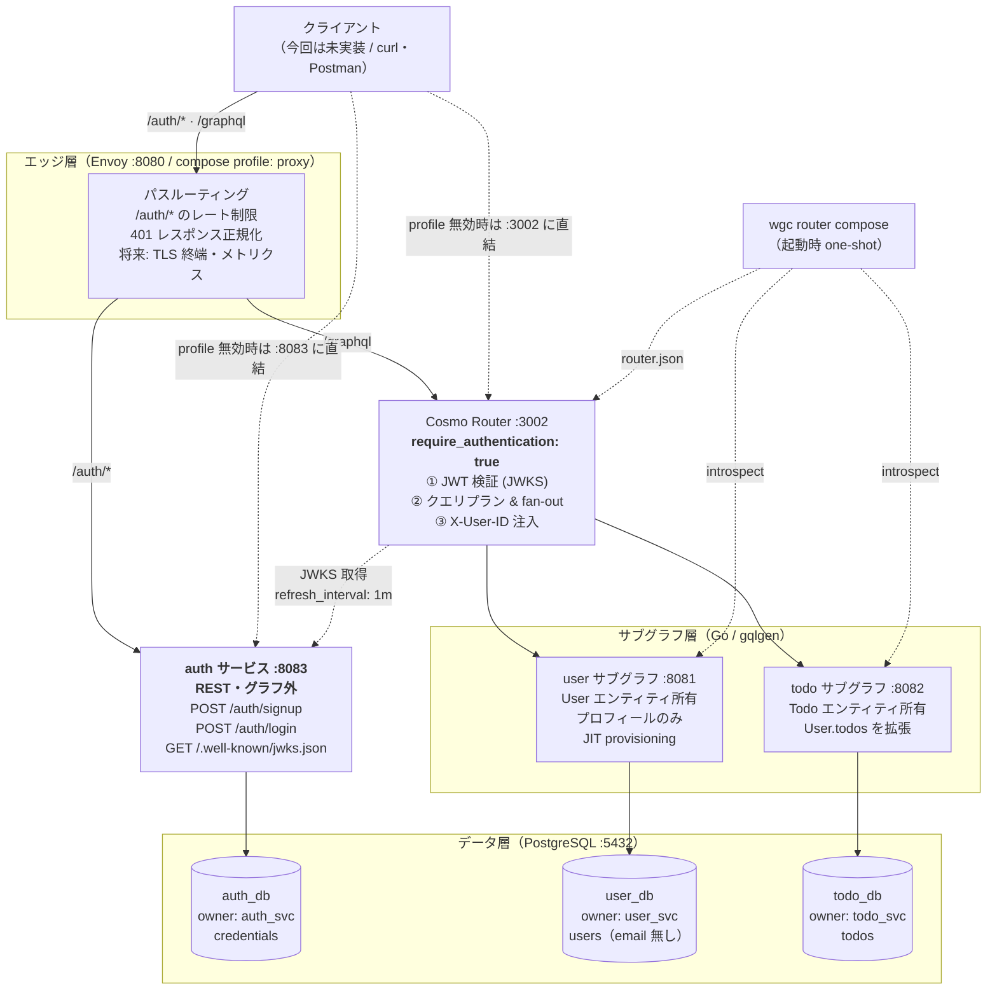
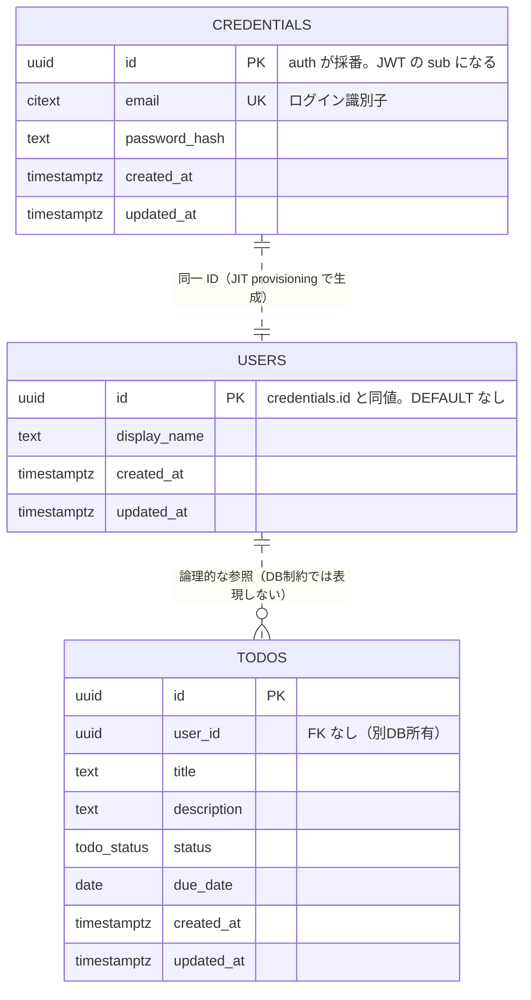
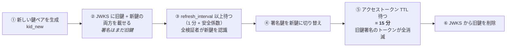
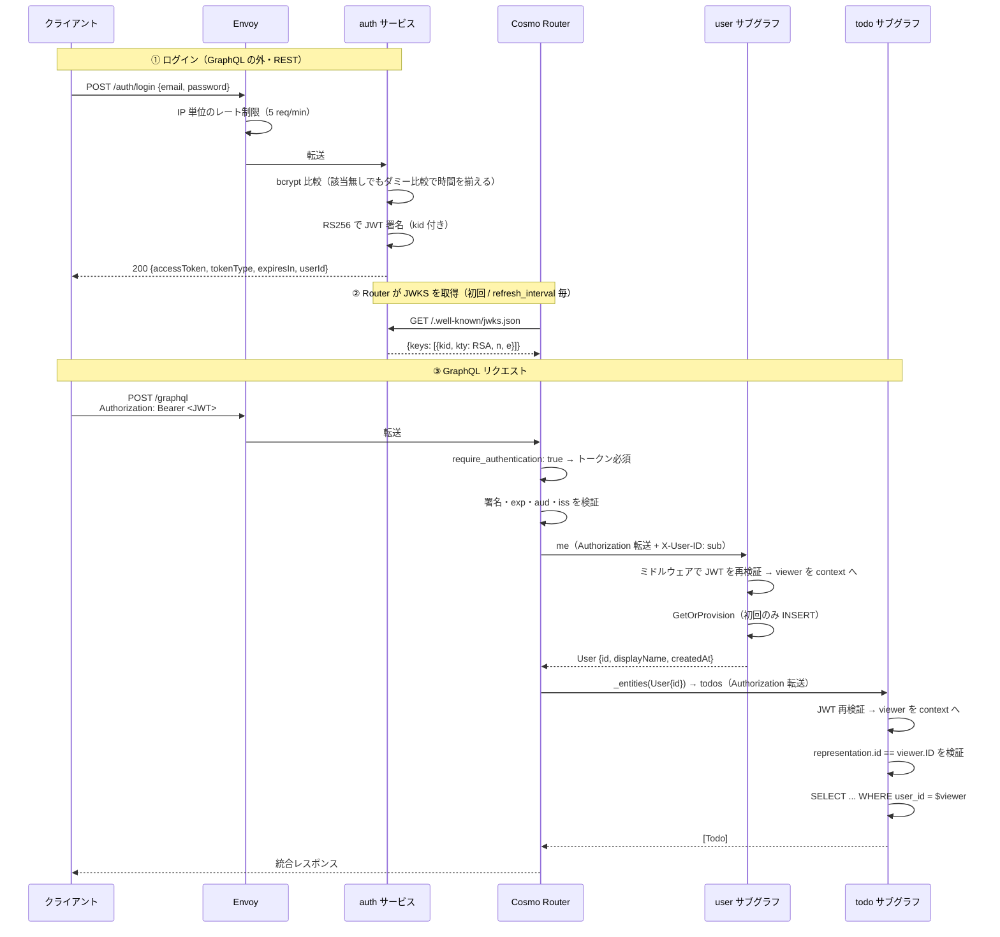
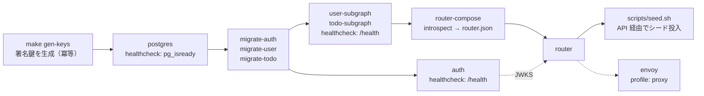
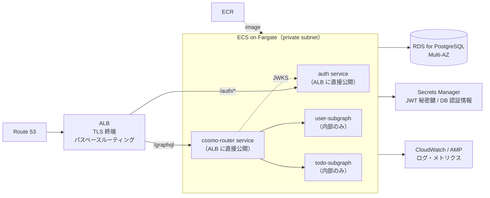

# GraphQL TODO アプリケーション 設計書

- ステータス: Draft（レビュー待ち）
- 最終更新: 2026-09-13
- スコープ: 開発環境で動く TODO の CRUD。本番構成は「候補の比較」までに留める。
- 決定記録: [ADR 0001 — 認証を user サブグラフから分離するか](adr/0001-authentication-service-separation.md)（Accepted）
- 検証待ち: [todo.md](../todo.md)

---

## 1. 概要とスコープ

複数ユーザーが利用する TODO アプリケーションのバックエンドを、GraphQL Federation
（WunderGraph Cosmo）によるマイクロサービス構成で構築する。

### やること

- TODO の CRUD（作成・一覧・取得・更新・削除）
- ユーザー登録 / ログイン（JWT 発行）
- 自分が作成した TODO 以外は一切見えない認可
- docker compose 一発で立ち上がる開発環境

### やらないこと（今回のスコープ外）

- キャッシュサーバー（Redis 等）
- 本番環境の IaC・CI/CD・監視の実装（構成候補の比較まで）
- フロントエンドクライアント
- GraphQL Subscription（リアルタイム更新）
- パスワードリセット / メール確認
- リフレッシュトークン（**ただし FE クライアントに着手する前に必ず実装する**。§6.1, §12-1）

---

## 2. 技術選定サマリ

| 領域 | 採用 | 理由 |
| --- | --- | --- |
| 言語 | Go 1.26 | 指定。ローカルに 1.26.1 導入済み |
| GraphQL サーバー | gqlgen v0.17 系 | schema-first。`federation.version: 2` で Federation v2 を公式サポート |
| DB アクセス | sqlc + pgx/v5 | SQL から型安全な Go コードを生成。ORM の暗黙的挙動が無く、認可の `WHERE` 句を明示的に書ける |
| マイグレーション | golang-migrate | up/down の SQL ファイルが素直。CLI がコンテナで動く |
| Federation | WunderGraph Cosmo Router | 指定 |
| スキーマ合成 | `wgc router compose`（ローカル静的合成） | control plane 不要。docker compose で完結する |
| **認証** | **自作 `auth` サービス（グラフ外・REST）RS256 + JWKS 公開** | **ADR 0001。グラフ外に置くことで Router の `require_authentication: true` が使え、設計がフェイルセーフになる** |
| **プロビジョニング** | **JIT provisioning（初回アクセス時に profile を作成）** | **分散トランザクションを回避しつつ、外部 IdP へ移行してもコードが変わらない** |
| DB | PostgreSQL 16（1 コンテナ / 論理 DB 分離） | `auth_db` / `user_db` / `todo_db` を接続ユーザーごと分離し、サービス間 JOIN を物理的に不可能にする |
| エッジプロキシ | Envoy（compose profile でオプトイン） | パスルーティング、ログインのレート制限、401 の正規化、将来のメトリクス |
| パスワードハッシュ | bcrypt (cost 12) | 標準ライブラリ準拠 (`golang.org/x/crypto/bcrypt`) で実装が単純 |

---

## 3. 全体アーキテクチャ



### サービスの責務

| サービス | グラフ参加 | 所有する型 / データ | 責務 |
| --- | --- | --- | --- |
| `auth` | **しない**（REST） | `credentials`（id, email, password_hash） | アカウント登録、ログイン、JWT 発行、JWKS 公開 |
| `user` サブグラフ | する | `User`（`id`, `displayName`, `createdAt`） | プロフィール管理、JIT provisioning |
| `todo` サブグラフ | する | `Todo` 全体、`User.todos` の拡張 | TODO の CRUD |

`User` は user サブグラフが所有し、todo サブグラフは `@key(fields: "id")` で
スタブとして参照しつつ `todos` フィールドを **追加** する。これにより
`me { todos { title } }` という 1 クエリが 2 サブグラフにまたがって解決され、
Federation の本質（型の分散所有と entity resolver）が実際に動く構成になる。

`auth` はグラフに参加しない。トークン発行に GraphQL の強み（フィールド選択、
entity 解決）が要らないうえ、グラフから公開オペレーションを排除することで
Router 全体を `require_authentication: true` で閉じられるため
（詳細は [ADR 0001](adr/0001-authentication-service-separation.md) §1.3）。

### ユーザー ID の一貫性

`credentials.id`（auth_db）= JWT の `sub` = `users.id`（user_db）= `todos.user_id`（todo_db）。
UUID を **auth サービスが採番**し、以降すべてのサービスがこの ID を参照する。
`users.id` に `DEFAULT gen_random_uuid()` を置かないのはこのため（外部から与えられる値）。

---

## 4. API 設計

### 4.1 auth サービス（REST / グラフ外）

| メソッド | パス | 認証 | 内容 |
| --- | --- | --- | --- |
| POST | `/auth/signup` | 不要 | アカウント作成 + トークン発行 |
| POST | `/auth/login` | 不要 | トークン発行 |
| GET | `/.well-known/jwks.json` | 不要 | 公開鍵の配信（Router・サブグラフが参照） |
| GET | `/health` | 不要 | ヘルスチェック |

```http
POST /auth/signup
Content-Type: application/json

{ "email": "a@example.com", "password": "pass1234", "displayName": "A" }
```

```http
201 Created
Content-Type: application/json

{
  "accessToken": "eyJhbGciOiJSUzI1NiIsImtpZCI6...",
  "tokenType": "Bearer",
  "expiresIn": 900,
  "userId": "9f1c...-....-....-....-............"
}
```

`/auth/login` はリクエストから `displayName` が無いだけで、レスポンス形は同じ。

REST にしたことで、HTTP ステータスコードが本来の意味で使えるようになる
（GraphQL では全て 200 + `errors` になる）。エラー設計は §9.1。

#### ログイン失敗時の扱い

- 「メールアドレスが存在しない」と「パスワードが違う」を**区別しない**。
  どちらも `401` + 固定メッセージ。区別するとメールアドレスの存在確認に使われる。
- メールアドレスが存在しない場合も、**ダミーのハッシュに対して bcrypt 比較を実行する**。
  比較を省略すると応答時間が明確に短くなり、タイミングから存在が漏れるため。

### 4.2 user サブグラフ

```graphql
extend schema
  @link(
    url: "https://specs.apollo.dev/federation/v2.5"
    import: ["@key", "@authenticated"]
  )

scalar Time

type User @key(fields: "id") @authenticated {
  id: ID!
  """
  user_db には保存せず、リクエストの JWT claims から解決する。
  他人の User エンティティを解決しても、手元にあるのは自分のトークンだけなので
  構造的に null にしかならない。
  """
  email: String
  displayName: String!
  createdAt: Time!
}

type Query {
  """認証済みユーザー自身。初回アクセス時に JIT provisioning が走る。"""
  me: User! @authenticated
}

type Mutation {
  """displayName の真実源は user_db 側。JWT の claim は初期値としてのみ使う。"""
  updateProfile(displayName: String!): User! @authenticated
}
```

`signUp` / `login` / `AuthPayload` は auth サービスへ移動したため、このスキーマから消えた。
結果として user サブグラフには**公開オペレーションが 1 つも無い**。

`User.email` を nullable にしているのは、他ユーザーのエンティティ解決時に `null` を
返して情報漏洩を防ぐため。non-null にすると親オブジェクトごと null に伝播して
クエリ全体が壊れる。

### 4.3 todo サブグラフ

```graphql
extend schema
  @link(
    url: "https://specs.apollo.dev/federation/v2.5"
    import: ["@key", "@authenticated"]
  )

scalar Time

enum TodoStatus {
  TODO
  DONE
}

type Todo @key(fields: "id") @authenticated {
  id: ID!
  title: String!
  description: String
  status: TodoStatus!
  dueDate: Time
  createdAt: Time!
  updatedAt: Time!
  """所有者。user サブグラフが残りのフィールドを解決する。"""
  user: User!
}

"""user サブグラフが所有する型を、todo サブグラフが拡張する"""
type User @key(fields: "id") {
  id: ID!
  todos(status: TodoStatus): [Todo!]! @authenticated
}

input TodoFilter {
  status: TodoStatus
  dueBefore: Time
}

input CreateTodoInput {
  title: String!
  description: String
  dueDate: Time
}

input UpdateTodoInput {
  title: String
  description: String
  status: TodoStatus
  dueDate: Time
}

type Query {
  todo(id: ID!): Todo @authenticated
  todos(filter: TodoFilter): [Todo!]! @authenticated
}

type Mutation {
  createTodo(input: CreateTodoInput!): Todo! @authenticated
  updateTodo(id: ID!, input: UpdateTodoInput!): Todo! @authenticated
  deleteTodo(id: ID!): Boolean! @authenticated
}
```

`UpdateTodoInput` は全フィールド nullable の部分更新（PATCH セマンティクス）。
「値を明示的に null にする」ケースは今回のスコープでは扱わない。

### 4.4 `@authenticated` を残す理由

Router で `require_authentication: true` を有効にすると、そもそも認証なしの
リクエストは Router を通過できない。したがって `@authenticated` は**冗長**になる。
それでも残すのは次の 2 点のため。

1. **自己文書化** — スキーマを読むだけで認証要否が分かる
2. **二重の保険** — Router 設定を誤って `require_authentication: false` に戻しても、
   フィールドレベルの防御が残る

エンティティ型（`Todo` / `User`）には OBJECT 単位で付けて全フィールドをまとめて
カバーし、ルートフィールドには個別に付ける。
※ ルート型（`type Query` 自体）への OBJECT 単位適用が Cosmo の composition で
意図通り動くかは未検証（[todo.md](../todo.md) #2）。

### 4.5 gqlgen 設定（両サブグラフ共通の要点）

```yaml
# services/{user,todo}/gqlgen.yml
schema:
  - graph/*.graphqls

exec:
  filename: graph/generated/generated.go
  package: generated

model:
  filename: graph/model/models_gen.go
  package: model

resolver:
  layout: follow-schema
  dir: graph
  package: graph

federation:
  filename: graph/federation.go
  package: graph
  version: 2

models:
  ID:
    model:
      - github.com/99designs/gqlgen/graphql.UUID
  Time:
    model:
      - github.com/99designs/gqlgen/graphql.Time
```

### 4.6 ページネーション（将来の拡張）

今回は `[Todo!]!` をそのまま返す。件数が増えた時点で Relay Cursor Connection
（`TodoConnection` / `TodoEdge` / `PageInfo`）へ移行する。カーソルは
`(created_at, id)` の複合キーを base64 エンコードしたものを想定。

---

## 5. データモデル



3 つの DB をまたぐ関連は、いずれも **DB 制約では表現しない**。
同じ UUID を共有するという規約だけで結び付ける。

### 5.1 auth_db

```sql
CREATE EXTENSION IF NOT EXISTS "pgcrypto";
CREATE EXTENSION IF NOT EXISTS "citext";

CREATE TABLE credentials (
    id            UUID PRIMARY KEY DEFAULT gen_random_uuid(),
    email         CITEXT      NOT NULL UNIQUE,
    password_hash TEXT        NOT NULL,
    created_at    TIMESTAMPTZ NOT NULL DEFAULT now(),
    updated_at    TIMESTAMPTZ NOT NULL DEFAULT now()
);
```

`CITEXT` を使うことで `Foo@example.com` と `foo@example.com` を同一視する。
アプリ側で `strings.ToLower` を忘れても一意制約が守られる。

`display_name` はここに持たない。auth が知る必要があるのは「サインアップ時に
受け取って JWT claim に載せる」までで、保存はしない（真実源は user_db）。

### 5.2 user_db

```sql
CREATE TABLE users (
    -- auth サービスが採番した ID を受け取る。DEFAULT を置かない
    id           UUID PRIMARY KEY,
    display_name TEXT        NOT NULL CHECK (char_length(display_name) BETWEEN 1 AND 50),
    created_at   TIMESTAMPTZ NOT NULL DEFAULT now(),
    updated_at   TIMESTAMPTZ NOT NULL DEFAULT now()
);
```

**`email` と `password_hash` を持たない**のが初版からの最大の変更点。
`email` は認証の識別子であって user サブグラフのドメインではなく、
`User.email` は JWT claims から解決する（§4.2）。

### 5.3 todo_db

```sql
CREATE EXTENSION IF NOT EXISTS "pgcrypto";

CREATE TYPE todo_status AS ENUM ('TODO', 'DONE');

CREATE TABLE todos (
    id          UUID PRIMARY KEY DEFAULT gen_random_uuid(),
    -- user_db.users.id を指すが、別サービス所有のため FK 制約は張らない
    user_id     UUID        NOT NULL,
    title       TEXT        NOT NULL CHECK (char_length(title) BETWEEN 1 AND 200),
    description TEXT,
    status      todo_status NOT NULL DEFAULT 'TODO',
    due_date    DATE,
    created_at  TIMESTAMPTZ NOT NULL DEFAULT now(),
    updated_at  TIMESTAMPTZ NOT NULL DEFAULT now()
);

-- 全てのクエリが user_id で絞り込まれるため、user_id を先頭に置く
CREATE INDEX todos_user_id_created_at_idx ON todos (user_id, created_at DESC);
CREATE INDEX todos_user_id_status_idx     ON todos (user_id, status);
```

複合インデックスの先頭列を `user_id` にしているのは設計上の必然。認可の
`WHERE user_id = $1` が全クエリに必ず付くため、この順序でしかインデックスが効かない。

### 5.4 接続ユーザーの分離

```sql
CREATE ROLE auth_svc LOGIN PASSWORD '...';
CREATE ROLE user_svc LOGIN PASSWORD '...';
CREATE ROLE todo_svc LOGIN PASSWORD '...';

CREATE DATABASE auth_db OWNER auth_svc;
CREATE DATABASE user_db OWNER user_svc;
CREATE DATABASE todo_db OWNER todo_svc;

-- PostgreSQL は PUBLIC ロールに CONNECT を既定で与える。
-- 個別ロールから REVOKE しても PUBLIC 経由で接続できてしまうため、
-- 「PUBLIC から剥奪 → 所有者にだけ GRANT」の順序でなければ意味がない。
REVOKE CONNECT ON DATABASE auth_db FROM PUBLIC;
REVOKE CONNECT ON DATABASE user_db FROM PUBLIC;
REVOKE CONNECT ON DATABASE todo_db FROM PUBLIC;

GRANT CONNECT ON DATABASE auth_db TO auth_svc;
GRANT CONNECT ON DATABASE user_db TO user_svc;
GRANT CONNECT ON DATABASE todo_db TO todo_svc;
```

`auth_db` への接続を他サービスから剥奪していることが、認証分離の実効性を担保する。
「user サブグラフのコードから `password_hash` に到達する経路が存在しない」ことを
インフラ側で保証する（ADR 0001 §2.2-D2 への対処）。

---

## 6. 認証・認可設計

### 6.1 トークン仕様

| 項目 | 値 |
| --- | --- |
| 発行者 | `auth` サービス（グラフ外） |
| 署名アルゴリズム | RS256（非対称鍵） |
| **有効期間** | **15 分**（`ACCESS_TOKEN_TTL`、開発・本番とも同じ既定値） |
| 許容するクロックスキュー | 30 秒（`exp` / `nbf` 判定のリーウェイ） |
| 鍵の配布 | auth サービスが `GET /.well-known/jwks.json` で公開鍵を配信（§6.2） |

```json
{
  "iss": "http://auth:8083",
  "sub": "9f1c...（credentials.id の UUID）",
  "aud": "graphql-todo-api",
  "iat": 1789000000,
  "exp": 1789000900,
  "jti": "01J...",
  "email": "foo@example.com",
  "display_name": "A",
  "scopes": ["todo:read", "todo:write"]
}
```

| claim | 用途 | 注意 |
| --- | --- | --- |
| `sub` | 全サービスの認可の根拠 | 唯一信頼してよい識別子 |
| `email` | `User.email` の解決元 | user_db に保存しない |
| `display_name` | **JIT provisioning の初期値としてのみ**使う | 発行時点のスナップショット。更新後は古くなるため、以降は user_db を参照する |

非対称鍵（RS256）を選ぶ理由は Federation 構成そのものにある。共通鍵（HS256）だと
検証したい全サービスに秘密鍵を配る必要があり、サービスが増えるほど漏洩面が広がる。
RS256 なら秘密鍵は auth サービスだけが持ち、Router もサブグラフも公開鍵で検証できる。

#### 有効期間を 15 分にした根拠（初版の 1 時間からの変更）

初版では 1 時間としていたが、再検討して **15 分に短縮**する。

**前提: 今の構成には失効手段が存在しない。**
RS256 のステートレス JWT は、発行後にサーバー側から無効化できない。
リフレッシュトークンもブロックリストもスコープ外である以上（§12-1, §12-2）、
**`exp` が唯一の失効手段**になっている。この状況では `exp` の長さが
そのまま「トークンが漏洩したとき攻撃者が使える時間」であり、
「パスワードを変えても攻撃者を追い出せない時間」でもある。

- 「ログアウト」はクライアントがトークンを捨てるだけで、
  通信を傍受されていれば `exp` まで使い続けられる
- 全体失効の手段は鍵ローテーション（§6.2）しかなく、これは全ユーザーを
  巻き込む最終手段

**1 時間は中途半端である。**
漏洩窓としては長すぎ、かといって FE から見れば「1 時間ごとに再ログイン」で
結局リフレッシュトークンが必要になる。どちらの目的も達成していない。

**短縮のコストは今ほぼゼロ。**
現時点のクライアントは curl / Postman だけで、再ログインは
`TOKEN=$(curl ... | jq -r .accessToken)` を撃ち直すだけ。
FE クライアントはスコープ外（§1）なので、UX 上の損失が発生しない。
逆に **15 分にしておくと、FE 着手前にリフレッシュトークンを設計せざるを得なくなる**。
制約を後で発見するより、早い段階で見える位置に置く方が安い。

**副次効果: 鍵ローテーションの所要時間が短くなる。**
ローテーション手順（§6.2）の待機時間はアクセストークン TTL に等しい。
1 時間 → 15 分にすることで、ローテーション完了までが約 65 分から約 20 分になる。

**次のステップ（§12-1 に反映）**: リフレッシュトークンを `auth_db` の
`refresh_tokens` テーブルに保存する方式にすれば、**Redis を導入せずに失効機構が手に入る**。
ログアウト＝該当行の DELETE で、アクセストークンは最大 15 分で自然に切れる。
「キャッシュサーバー不要」という前提（§1）と衝突しない。
FE クライアントに着手する前に必ず実装する。

| TTL | 漏洩時の被害窓 | 再ログイン頻度（FE 無し） | 評価 |
| --- | --- | --- | --- |
| 5 分 | 極小 | 検証作業の途中で切れる | 過剰。リフレッシュ無しでは運用しにくい |
| **15 分** | **小** | **ほぼ影響なし** | **採用** |
| 1 時間 | 中 | 影響なし | 漏洩窓として長い。FE が来れば結局足りない |
| 24 時間 | 大 | 影響なし | 失効手段が無い構成では許容できない |

---

### 6.2 署名鍵と JWKS の管理

`auth` が秘密鍵で署名し、Router と 2 つのサブグラフが公開鍵で検証する。
その公開鍵をどう配るかが JWKS（JSON Web Key Set）の役割になる。

#### なぜ PEM の配布ではなく JWKS なのか

| 方式 | 鍵をローテーションするとき |
| --- | --- |
| 公開鍵 PEM を各サービスの設定に埋め込む | Router + user + todo の**3 サービスを再デプロイ**する必要がある |
| **JWKS を HTTP で配信** | **auth が配信内容を差し替えるだけ。他サービスは無停止** |

鍵は「いつか必ず替えるもの」なので、替えるコストが再デプロイ 3 件になる設計は
実質「替えられない」設計になる。JWKS はこれを避けるための仕組み。

#### JWKS ドキュメントの形

```json
{
  "keys": [
    {
      "kty": "RSA",
      "use": "sig",
      "alg": "RS256",
      "kid": "5Hc0m...（RFC 7638 の JWK Thumbprint）",
      "n": "0vx7agoebGcQSuu...（modulus / base64url）",
      "e": "AQAB"
    }
  ]
}
```

- **`kid`（Key ID）が要**。JWT のヘッダにも `kid` が入っており、検証側は
  「このトークンはどの鍵で署名されたか」を `kid` で引く。
  **複数の鍵を同時に載せられる**ことがローテーションを可能にしている。
- `kid` は **RFC 7638 の JWK Thumbprint**（正規化した JWK の SHA-256）で決める。
  鍵から決定的に導出されるため、サービス間で採番を調整する必要がない。
- `use: "sig"` / `alg: "RS256"` を明示し、検証側が用途外利用を弾けるようにする。

#### 鍵の生成と保管

| 環境 | 保管場所 | 生成方法 |
| --- | --- | --- |
| 開発 | `secrets/dev/jwt_private.pem`（**gitignore**） | `make gen-keys`（`openssl genrsa 2048` 相当） |
| 本番 | AWS Secrets Manager（`auth` のタスク定義から環境変数で注入） | 手動生成 → Secrets Manager に登録 |

守るべき規則が 2 つある。

1. **公開鍵は保存しない。** 起動時に秘密鍵から導出する（Go なら `privKey.Public()`）。
   別々に保存すると「秘密鍵は替えたが公開鍵の配信が古い」という不整合が起き得る。
   真実源は秘密鍵ひとつ。
2. **開発用の鍵を毎回生成し直さない。** コンテナ再起動のたびに `kid` が変わると、
   発行済みトークンが全て無効になり、Router の JWKS キャッシュも古くなる。
   `make gen-keys` は**既にファイルがあれば何もしない**（冪等）実装にする。

秘密鍵を持つのは `auth` だけ。user / todo サブグラフにも Router にも渡さない。

#### 誰がどう取得するか

| 消費者 | 取得方法 | キャッシュ |
| --- | --- | --- |
| Cosmo Router | `authentication.providers[].jwks.url`（§6.5） | `refresh_interval: 1m` で定期更新 |
| user / todo サブグラフ | Go の `keyfunc` ライブラリで同じ URL を参照 | ライブラリがバックグラウンド更新 |
| auth サービス自身 | **取得しない**。手元の秘密鍵を直接使う | — |

#### ローテーション手順（無停止）



順序が重要な理由:

- **② を ④ より先に**やらないと、新鍵で署名されたトークンを検証側が
  「未知の `kid`」として弾く（＝全リクエストが 401 になる）
- **⑥ を ⑤ より先に**やると、まだ有効期限内の旧トークンが検証できなくなる

所要時間は合計で約 20 分。§6.1 で TTL を 15 分にしたことで、
1 時間のときの約 65 分から短縮されている。

**緊急時（秘密鍵の漏洩）**は ⑤ の待機を飛ばし、⑥ を即座に実行する。
発行済みトークンが全て無効になり全ユーザーが再ログインを強いられるが、
**これが現構成で唯一の「全体失効」手段**である（§6.1 / §12-2）。

#### 障害時の挙動

- **`refresh_unknown_kid`**（Router 設定 §6.5）— 未知の `kid` を見たとき、
  次の定期更新を待たずに JWKS を再取得する。ローテーションが定期更新の
  合間に起きた場合の保険。無制限に再取得しないよう `interval` / `burst` で
  レート制限する（JWKS エンドポイントへの DoS を自分で起こさないため）。
- **auth サービスが落ちた場合** — 検証側は**直前に取得できた JWKS を保持し続ける**
  実装にする。auth が停止していても既存トークンの検証は継続でき、
  影響は「新規ログインができない」だけに限定される。
  auth を Router の JWKS 取得先にしたことによる可用性の結合を、
  キャッシュの粘り強さで緩和する。
- 起動順序では `router` が `auth: service_healthy` を待つ（§8.2）。
  初回取得の失敗を避けるため。

#### セキュリティ上の注意

1. **JWKS エンドポイントは認証不要でよい**（公開鍵しか含まないため）。
   ただし**本番では必ず TLS か VPC 内部通信にする**。
   JWKS の取得経路を中間者に差し替えられると、攻撃者は自分の鍵で
   トークンを偽造できてしまう。「公開情報だから平文でよい」は誤り
   — 守るべきは機密性ではなく**完全性**。
2. **検証側で `alg` を固定する。** `algorithms: ["RS256"]` を必ず指定し、
   `alg: none` や、公開鍵を HMAC の共通鍵として使わせる
   アルゴリズム混同攻撃を防ぐ。Router 設定（§6.5）とサブグラフの
   ミドルウェア（§6.6）の**両方**で指定する。
3. **秘密鍵を JWKS に混ぜない。** ハンドラは公開部分（`n`, `e`）から
   JWK を明示的に組み立てる。鍵構造体をそのまま marshal する実装にしない。
4. `secrets/` は `.gitignore` に入れ、`.env.example` にも鍵そのものは書かない。

### 6.3 認証フロー



### 6.4 JIT provisioning

`auth_db` に credentials、`user_db` に profile があり、2 つの DB への書き込みを
どう整合させるかが分離後の主要な論点になる。分散トランザクションを避けるため、
**auth は credentials だけを作り、profile は初回アクセス時に user サブグラフが作る**。

```go
// services/user/internal/service/provisioning.go（構造のみ）
//
// 1. まず PK の SELECT を撃つ（インデックスが効くので極めて安い）
// 2. 見つからなければ claims を初期値として INSERT
//
// 毎リクエスト INSERT を撃たないのは、書き込みの往復を避けるため。
// ON CONFLICT DO NOTHING なので、同時実行で競合しても安全。
func (s *UserService) GetOrProvision(ctx context.Context, v *auth.Viewer) (*db.User, error)
```

```sql
-- name: GetUser :one
SELECT * FROM users WHERE id = $1;

-- name: ProvisionUser :one
INSERT INTO users (id, display_name)
VALUES ($1, $2)
ON CONFLICT (id) DO NOTHING
RETURNING *;
```

**プロビジョニングしてよいのは viewer 自身の行だけ。**
entity resolver `FindUserByID(id)` は Router から任意の ID で呼ばれ得るため、
`id != viewer.UserID` の場合は SELECT のみ行い、行が無ければ `null` を返す。
ここで provisioning を走らせると、任意の UUID で `users` に行を作れてしまう。

#### この方式のトレードオフ

- 正常系として **「auth_db にはいるが user_db にはまだいない」状態が存在する**。
  サインアップ直後、`me` を一度も呼んでいないユーザーがこれにあたる。
- 将来「管理者向けユーザー一覧」を作ると、未プロビジョニングのユーザーが見えない。
  そのときは auth 側を一覧の真実源にするか、サインアップ時に同期を入れるか
  再設計が必要（§12-8）。
- 見返りとして、**外部 IdP（Cognito / Auth0）へ移行してもこのコードは 1 行も変わらない**。
  IdP は自社の `users` テーブルに行を作ってくれないため、JIT provisioning は
  IdP 利用時の標準手順そのものになっている。

### 6.5 Cosmo Router の設定

```yaml
# router/config.yaml
version: "1"

listen_addr: "0.0.0.0:3002"
execution_config:
  file:
    path: /app/router.json

authentication:
  jwt:
    jwks:
      - url: "http://auth:8083/.well-known/jwks.json"
        refresh_interval: 1m
        algorithms: ["RS256"]
        audiences: ["graphql-todo-api"]
        refresh_unknown_kid:
          enabled: true   # 鍵ローテーション直後の 401 を防ぐ
          max_wait: 2m
          interval: 30s
          burst: 2
    header_name: Authorization
    header_value_prefix: Bearer

authorization:
  # グラフから公開オペレーション（login / signUp）が消えたので true にできる。
  # ADR 0001 の採用によって初めて可能になった設定。
  require_authentication: true
  reject_operation_if_unauthorized: true

headers:
  all:
    request:
      # Router はデフォルトで認証ヘッダをサブグラフへ転送しない。
      # サブグラフ側の再検証に必要なため明示的に伝播させる。
      - op: "propagate"
        named: "Authorization"
      # 検証済みの sub をヘッダに注入（ログ・トレース用。認可の根拠には使わない）
      - op: "set"
        name: "X-User-ID"
        expression: "request.auth.isAuthenticated ? request.auth.claims.sub : ''"

telemetry:
  # Router は既定で Cosmo Cloud へトレース／メトリクスを送信する。
  # 外部依存を持たない構成にするため明示的に止める。
  tracing:
    enabled: false
  metrics:
    otlp:
      enabled: false
    prometheus:
      enabled: true
      listen_addr: "0.0.0.0:8088"
      path: "/metrics"
```

> **実装時に判明した点**（router v0.346.1 で検証済み）
>
> - 認証設定は `authentication.providers[]` ではなく `authentication.jwt.jwks[]`。
>   `providers` 形式は config schema に弾かれる。
> - 静的な execution config を使う場合、**`GRAPH_API_TOKEN` を設定してはいけない**。
>   設定すると JWT として解釈され `invalid token` で起動に失敗する。
> - Router は既定で `cosmo-otel.wundergraph.com` へ telemetry を送る。上記で無効化する。

#### `require_authentication: true` がもたらす性質の変化

| | 変更前（認証がグラフ内） | 変更後（認証がグラフ外） |
| --- | --- | --- |
| デフォルト | 公開 | **全閉** |
| `@authenticated` の役割 | これを付けて初めて閉じる | すでに閉じているものの自己文書化 |
| 付け忘れたとき | **誰でも読める（漏洩）** | アクセスできない（開発中に気づく） |
| 設計の性質 | フェイルオープン | **フェイルセーフ** |

同じ人間のミスでも、結果が「漏洩」から「動かない」に変わる。

#### 開発上の注意

`require_authentication: true` にすると、**GraphQL Playground や IDE の
introspection クエリもトークンを要求される**。Playground の HTTP ヘッダ欄に
`Authorization: Bearer ...` を設定して使う。
`wgc router compose` はサブグラフを直接 introspect するため影響を受けない。

### 6.6 サブグラフ側の再検証（多層防御）

Router を通らずサブグラフのポートに直接到達された場合、`X-User-ID` は
いくらでも詐称できる。したがって **認可の根拠は常に自分で検証した JWT** とする。

```go
// internal/auth/middleware.go（構造のみ）

type Viewer struct {
    UserID      uuid.UUID
    Email       string
    DisplayName string
    Scopes      []string
}

type ctxKey struct{}

// Middleware は Authorization ヘッダの JWT を JWKS で検証し、
// 成功時のみ context に Viewer を格納する。
// 検証に失敗しても 401 は返さず「未認証のまま通す」——
// 可否の判定は resolver 層に委ねる。
func Middleware(jwks *keyfunc.Keyfunc) func(http.Handler) http.Handler

// ViewerFromContext は未認証なら ErrUnauthenticated を返す。
// 認証必須の resolver は必ず先頭でこれを呼ぶ。
func ViewerFromContext(ctx context.Context) (*Viewer, error)
```

両サブグラフとも auth サービスの JWKS URL（`http://auth:8083/.well-known/jwks.json`）を
参照する。auth サービス自身は署名者なので、JWKS を HTTP 取得せず手元の鍵を直接使う。

分離前は user サブグラフが自分の発行したトークンを自分で検証していたが、
分離後は **3 サービス全てが対等に「外部の IdP が発行したトークンを検証する側」**になる。
検証ロジックが 1 種類に揃い、共有パッケージに切り出しやすくなった。

### 6.7 認可の実装ルール

以下を破ると即座に情報漏洩になる、という前提のルール。

1. **sqlc のクエリは `user_id` を必ず引数に取る。**
   `WHERE id = $1` だけのクエリは書かない。常に `WHERE id = $1 AND user_id = $2`。

   ```sql
   -- db/todo/queries/todos.sql
   -- name: GetTodo :one
   SELECT * FROM todos WHERE id = $1 AND user_id = $2;

   -- name: ListTodos :many
   SELECT * FROM todos
   WHERE user_id = $1
     AND (sqlc.narg('status')::todo_status IS NULL OR status = sqlc.narg('status'))
   ORDER BY created_at DESC;

   -- name: UpdateTodo :one
   UPDATE todos SET ... , updated_at = now()
   WHERE id = @id AND user_id = @user_id
   RETURNING *;

   -- name: DeleteTodo :execrows
   DELETE FROM todos WHERE id = $1 AND user_id = $2;
   ```

   UPDATE / DELETE も `WHERE` で絞る。「取得して所有者チェックしてから更新」だと
   チェックと更新の間に競合が入り得るうえ、チェック漏れの余地が残る。

2. **他人のリソースは `NOT_FOUND` を返す。** `FORBIDDEN` を返すと
   「その ID は存在する」という情報が漏れる（存在推測攻撃）。

3. **entity resolver は Query 経由の認可を迂回する。**
   `FindUserByID(ctx, id)` は Router から任意の ID で呼ばれ得るため、
   `User.todos` の resolver で `user.ID == viewer.UserID` を必ず検証する。
   同じ理由で、他人の ID では **provisioning を走らせない**（§6.4）。
   ここは Federation 特有の落とし穴で、Query ルートだけ守っても塞げない。

4. **`user_id` はリクエストボディから絶対に受け取らない。**
   `CreateTodoInput` に `userId` を持たせず、常に context の viewer から取る。

5. **`X-User-ID` ヘッダを認可の根拠に使わない。**
   ログ・トレース用途のみ。認可は必ず自分で検証した JWT の `sub` から導く。

### 6.8 認可ポリシー表

主要なケースの期待挙動。実装時のテストケースと 1:1 対応させる。

| # | 操作 | 状況 | 期待する挙動 |
| --- | --- | --- | --- |
| 1 | `POST /auth/login` | 未認証 | 成功（グラフ外の公開エンドポイント） |
| 2 | `POST /auth/login` | メール不在 / パスワード相違 | どちらも `401` + 固定メッセージ。ダミー bcrypt 比較で応答時間も揃える |
| 3 | `POST /auth/signup` | メール重複 | `409 Conflict` |
| 4 | 任意の GraphQL クエリ | 未認証（Authorization ヘッダ無し） | **Router が 401 で拒否**（`require_authentication: true`）。サブグラフに到達しない |
| 5 | `todo(id:)` | 他人の TODO の ID | `null` + `NOT_FOUND`（`FORBIDDEN` は使わない） |
| 6 | `updateTodo` / `deleteTodo` | 他人の TODO の ID | 更新・削除 0 件 → `NOT_FOUND` エラー |
| 7 | `me { todos }` | 認証済み・正常系 | 自分の TODO 一覧。0 件でも `null` ではなく **空配列 `[]`** を返す |
| 8 | `_entities(User{id: 他人})` からの `User.todos` | Router 経由で他人の User が解決された | **空配列 `[]`**（エラーにしない）。provisioning も走らせない |
| 9 | 任意の認証必須クエリ | JWT の `exp` 切れ | **Router が先に弾く**。`UNAUTHENTICATED` で 401。期限切れ・署名不正・改竄を**区別しない** |
| 10 | `me` | サインアップ直後、`user_db` に行が無い | JIT provisioning で行が作られ、正常に `User` が返る |
| 11 | `_entities(User{id: 他人})` | `user_db` に他人の行が存在しない | provisioning せず `null` を返す（任意の UUID で行を作らせない） |
| 12 | `createTodo` | サブグラフのポートへ直接アクセス + `X-User-ID` 詐称（Authorization ヘッダなし） | 未確定（要検証 → [todo.md](../todo.md) #1） |

#### 補足: 各判断の根拠

**#2 / #9 — 失敗理由を区別しない。**
`exp` 切れ・署名不正・`aud` 不一致を別メッセージにすると、攻撃者に
「署名は正しいが期限だけ切れている」＝**トークンの構造は正しい**というフィードバックを
与えてしまう。総当たりや改竄の試行錯誤に手がかりを渡さない。

- クライアントへは一律 `UNAUTHENTICATED` / メッセージも固定文字列に正規化する。
- 実装注意: Cosmo Router 自身のエラーメッセージが理由別に異なる場合は、
  Envoy の `local_reply_config` でレスポンスボディを差し替えるか、
  Router の custom module でエラーを正規化する（§8.5）。
- 詳細な理由はサーバーログにのみ `slog` で残し、運用側では追えるようにする。
- トレードオフ: クライアントが「期限切れなら自動リフレッシュ」という導線を作れない。
  リフレッシュトークン導入時（§12-1）に、`WWW-Authenticate: Bearer error="invalid_token"`
  ヘッダを使うかどうかを再検討する。

**#7 — 空配列に統一する。**
`[Todo!]!` を non-null リストにしているのはこの方針の裏返し。「該当なし」を
`null` で表すとクライアントが `null` と `[]` の両方をハンドリングする必要が生じる。
DB のクエリ結果が 0 行でも sqlc の `:many` は `nil` スライスを返し、
`nil` スライスは JSON で `null` にシリアライズされるため、resolver で
`if todos == nil { todos = []*model.Todo{} }` の正規化を挟む。

**#8 — 空配列を返す。エラーを返さない。**
#5（`NOT_FOUND`）と一見矛盾するが、守る対象が違う。

- #5 は「攻撃者が任意の UUID を投げて、その TODO の存在を推測する」経路。
  レスポンスが存在の有無で変わると情報が漏れるため `NOT_FOUND` に倒す。
- #8 は「Router が正規のクエリプランの中で User を解決した」経路。
  その User の存在自体は user サブグラフ側ですでに確定しており、todo サブグラフが
  改めて隠す意味がない。むしろここでエラーを返すと、レスポンスの差異が
  「そのユーザーは存在する」というシグナルになる。

空配列なら「TODO を 1 件も持たない他人」と「他人なので見せない」が
**外形的に区別できない**。実装上は entity resolver 内で `user.ID != viewer.UserID` なら
DB に問い合わせず即座に `[]` を返す（無駄なクエリも撃たない）。

**#11 — 他人の ID では provisioning しない。**
`FindUserByID` は Router から任意の representation で呼ばれる。ここで
「行が無ければ作る」を無条件に適用すると、`users` テーブルに任意の UUID の行を
作らせる書き込み経路になる。provisioning の対象は常に viewer 自身に限る。

---

## 7. ディレクトリ構成

```
graphql-todo/
├── docs/
│   ├── design.md                  # 本ドキュメント
│   └── adr/
│       └── 0001-authentication-service-separation.md
├── todo.md                        # 検証待ち事項
├── compose.yaml                   # 開発環境一式
├── Makefile                       # up / down / gen-keys / migrate / compose-router / sqlc
├── .env.example
├── router/
│   ├── graph.yaml                 # wgc router compose の入力（サブグラフ一覧）
│   ├── config.yaml                # Cosmo Router 設定
│   └── router.json                # 生成物（gitignore）
├── envoy/
│   └── envoy.yaml
├── scripts/
│   └── seed.sh                    # 開発用シードデータ（API 経由・冪等）
├── secrets/dev/                   # 開発用 RSA 鍵（gitignore）
├── db/
│   ├── init/00-databases.sql      # DB / ロール作成（postgres コンテナの初期化）
│   ├── auth/
│   │   ├── migrations/
│   │   └── queries/credentials.sql
│   ├── user/
│   │   ├── migrations/
│   │   └── queries/users.sql
│   └── todo/
│       ├── migrations/
│       └── queries/todos.sql
└── services/
    ├── auth/                      # ★ グラフに参加しない REST サービス
    │   ├── go.mod
    │   ├── sqlc.yaml
    │   ├── Dockerfile
    │   ├── cmd/server/main.go
    │   └── internal/
    │       ├── config/            # 環境変数の読み込み
    │       ├── handler/           # /auth/signup, /auth/login, /.well-known/jwks.json
    │       ├── issuer/            # RS256 署名・JWKS 生成・kid 管理
    │       ├── password/          # bcrypt ラッパ（ダミー比較を含む）
    │       └── db/                # sqlc 生成物
    ├── user/
    │   ├── go.mod
    │   ├── gqlgen.yml
    │   ├── sqlc.yaml
    │   ├── Dockerfile
    │   ├── cmd/server/main.go
    │   ├── graph/
    │   │   ├── schema.graphqls
    │   │   ├── generated/         # gqlgen 生成物（federation.go もここ）
    │   │   ├── model/
    │   │   ├── convert.go         # DB 行 → GraphQL モデル
    │   │   ├── resolver.go        # 依存注入
    │   │   ├── schema.resolvers.go
    │   │   └── entity.resolvers.go  # Federation の entity resolver
    │   └── internal/
    │       ├── config/
    │       ├── auth/              # JWT 検証ミドルウェア（発行機能は持たない）
    │       ├── apperr/            # extensions.code 付きの GraphQL エラー
    │       ├── db/                # sqlc 生成物
    │       └── service/           # provisioning.go を含む
    └── todo/                      # user と同じ構成
```

### 実装で設計書から変更した点

| 項目 | 設計書（初版） | 実装 | 理由 |
| --- | --- | --- | --- |
| federation の生成先 | `graph/federation.go` | `graph/generated/federation.go` | gqlgen は federation と exec が同一パッケージであることを要求する |
| auth の署名パッケージ | `internal/token/` | `internal/issuer/` | ローカルの権限設定が `token` を含むパスへの書き込みを拒否したため |
| `User.todos` の解決 | （記載なし） | gqlgen.yml で `resolver: true` を明示 | 指定しないと gqlgen がモデルのフィールドに直接束縛し、`status` 引数も認可チェックも効かなくなる |

`internal/auth/`（検証ミドルウェア）は user / todo で内容がほぼ同じになる。
当面はコピーで開始し、3 つ目の利用者が出た時点で共有モジュール化を検討する
（早すぎる共通化を避ける）。

`golang/` 配下ではなくリポジトリ直下に置く理由: このプロジェクトは Go 以外
（Envoy 設定、Router 設定、SQL、compose）を多く含む複合プロジェクトであり、
既存の `golang/` が持つ「言語別の学習サンプル置き場」という性格と異なるため。

`router/graph.yaml` を `compose.yaml` と別名にしているのは、wgc の入力ファイルが
慣例的に `compose.yaml` という名前で、docker compose のそれと紛らわしいため。

---

## 8. 開発環境

### 8.1 docker compose のサービス構成

| サービス | イメージ | ポート | 役割 |
| --- | --- | --- | --- |
| `postgres` | `postgres:16-alpine` | 5432 | `db/init/` で 3 DB + 3 ロールを作成 |
| `migrate-auth` | `migrate/migrate` | - | one-shot |
| `migrate-user` | `migrate/migrate` | - | one-shot |
| `migrate-todo` | `migrate/migrate` | - | one-shot |
| **`auth`** | ローカルビルド | **8083** | REST + `/.well-known/jwks.json` + `/health` |
| `user-subgraph` | ローカルビルド | 8081 | GraphQL + `/health` |
| `todo-subgraph` | ローカルビルド | 8082 | GraphQL + `/health` |
| `router-compose` | `node:22-alpine` | - | one-shot。`npx wgc router compose -i /work/graph.yaml -o /work/router.json` |
| `router` | `ghcr.io/wundergraph/cosmo/router` | 3002, 8088 | Federation Router + Prometheus |
| `envoy` | `envoyproxy/envoy:v1.31-latest` | 8080, 9901 | **profile: `proxy`** |

### 8.2 起動順序



`router-compose` はサブグラフを introspection するため、サブグラフが healthy に
なるまで待つ必要がある。compose では次の依存で表現する。

```yaml
  router-compose:
    depends_on:
      user-subgraph: { condition: service_healthy }
      todo-subgraph: { condition: service_healthy }

  router:
    depends_on:
      router-compose: { condition: service_completed_successfully }
      auth: { condition: service_healthy }   # 起動直後の JWKS 取得失敗を避ける
```

`auth` はサブグラフに依存しない（グラフに参加しないため）。逆にサブグラフは
JWKS 取得のため auth に依存するが、JWKS の取得は遅延評価でよいので
`depends_on` は張らず、初回検証時に取得してキャッシュする実装にする。

### 8.3 wgc の入力ファイル

```yaml
# router/graph.yaml
version: 1
subgraphs:
  - name: user
    routing_url: http://user-subgraph:8081/graphql
    introspection:
      url: http://user-subgraph:8081/graphql
  - name: todo
    routing_url: http://todo-subgraph:8082/graphql
    introspection:
      url: http://todo-subgraph:8082/graphql
```

`auth` はここに現れない。グラフに参加しないサービスなので合成の対象外。

`wgc router compose` は control plane に接続せずローカルで完結する。本番では
Schema Registry を使う `wgc router fetch` に切り替えるのが公式の推奨。

### 8.4 クライアントから見た入口

認証をグラフの外に出したことで、入口が 2 つになった。

| 起動方法 | ログイン | GraphQL |
| --- | --- | --- |
| `docker compose up -d`（Envoy 無し） | `http://localhost:8083/auth/login` | `http://localhost:3002/graphql` |
| `docker compose --profile proxy up -d` | `http://localhost:8080/auth/login` | `http://localhost:8080/graphql` |

本番では必ず単一の入口（ALB / Envoy）にパスで振り分ける。開発で 2 ポートを
許容しているのは、Envoy を必須にすると起動が重くなるため
（[ADR 0001](adr/0001-authentication-service-separation.md) §3-案1 の選択肢 (i)）。
ベース URL は `.env` で切り替えられるようにしておく。

### 8.5 Envoy の役割

初版では「将来のメトリクス用」だったが、認証分離によって初日から実務的な責務を持つ。

| パス | 転送先 | 追加設定 |
| --- | --- | --- |
| `/auth/login`, `/auth/signup` | auth サービス | **IP あたり 5 req/min のレート制限**（ブルートフォース対策） |
| `/.well-known/jwks.json` | auth サービス | レート制限なし |
| `/graphql` | Cosmo Router | — |
| （共通） | — | **401 レスポンスボディの正規化**（§6.8-#9）、アクセスログ、admin(:9901) |

ログインのレート制限は、認証がグラフ内にあった頃は実質不可能だった
（Router から見れば `POST /graphql` の一種でしかなく、パス単位で絞れない）。
パスが分かれたことで初めて可能になった。

`/stats/prometheus` でエッジのメトリクスが取れる状態を作っておき、後から
リトライ・TLS 終端・OpenTelemetry トレースを足していく。Cosmo Router 自体も
OTEL / Prometheus を持つため、Envoy の役割は「エッジ固有の関心事」に絞る。

profile を有効にしない場合、パスルーティングと 401 正規化は効かない。
これらを検証する E2E テストは `--profile proxy` 前提で書く。

### 8.6 主要な Make ターゲット

| コマンド | 内容 |
| --- | --- |
| `make gen-keys` | 開発用 RSA 鍵ペアを `secrets/dev/` に生成 |
| `make up` | 起動してシードまで投入（`SKIP_SEED=1` で投入を飛ばせる） |
| `make up-proxy` | Envoy 込みで起動してシード投入 |
| `make seed` | シードデータの投入のみ（冪等） |
| `make down` | `docker compose down -v` |
| `make sqlc` | 3 サービスの sqlc generate |
| `make gqlgen` | 2 サブグラフの gqlgen generate |
| `make router` | `router.json` を再生成し router を再起動 |
| `make migrate-new NAME=xxx SVC=todo` | マイグレーションファイルの雛形生成 |

### 8.7 シードデータ

`scripts/seed.sh` が開発用のデータを投入する。`make up` の最後で自動実行され、
単体では `make seed`、飛ばすときは `SKIP_SEED=1 make up`。

| ユーザー | パスワード | TODO |
| --- | --- | --- |
| alice@example.com | password123 | 3 件（うち 1 件 DONE） |
| bob@example.com | password123 | 2 件 |

2 ユーザー用意するのは、§6.8-#5「他人の TODO は NOT_FOUND」を
手で確認できる状態を最初から作っておくため。

#### SQL ではなく API 経由で投入する理由

`credentials`（auth_db）・`users`（user_db）・`todos`（todo_db）は物理的に別の DB にあり、
**同じ UUID を共有するという規約だけ**で結び付いている（§3「ユーザー ID の一貫性」）。
SQL で直接 INSERT すると、その規約をシードスクリプト側で手作業で複製することになり、
サービスが持つべき責務がシードへ漏れ出す。ロールごとに `CONNECT` を剥奪している
（§5.4）ため、そもそも 1 つの接続で 3 つの DB に書くこともできない。

API 経由なら JIT provisioning（§6.4）もそのまま通るため、
シードの実行自体が開発環境の疎通確認を兼ねる。

冪等性は次の 2 段で確保する。

- signup が `409` を返したら login にフォールバックする
- `todos` が 1 件でもあれば TODO の作成をスキップする

### 8.8 動作確認

```bash
# 1. サインアップ（REST・グラフの外）
TOKEN=$(curl -s localhost:8083/auth/signup \
  -H 'content-type: application/json' \
  -d '{"email":"a@example.com","password":"pass1234","displayName":"A"}' \
  | jq -r .accessToken)

# 2. 未認証で GraphQL を叩く → Router が 401（require_authentication: true）
curl -i -s localhost:3002/graphql -H 'content-type: application/json' \
  -d '{"query":"{ todos { id } }"}'

# 3. TODO 作成
curl -s localhost:3002/graphql \
  -H "authorization: Bearer $TOKEN" -H 'content-type: application/json' \
  -d '{"query":"mutation { createTodo(input: {title: \"設計書をレビューする\"}) { id status } }"}'

# 4. federation をまたぐクエリ + JIT provisioning の確認
#    （user_db に行が無い状態でも me が成功し、以後 users に行ができる）
curl -s localhost:3002/graphql \
  -H "authorization: Bearer $TOKEN" -H 'content-type: application/json' \
  -d '{"query":"{ me { id email displayName todos { title } } }"}'

# 5. 認可の確認（B のトークンで A の TODO を引く → null + NOT_FOUND）
```

---

## 9. エラー設計

認証をグラフの外に出したことで、エラー表現が 2 系統になった。

### 9.1 auth サービス（REST）

| HTTP | 状況 | ボディ |
| --- | --- | --- |
| 201 | サインアップ成功 | トークン |
| 200 | ログイン成功 | トークン |
| 400 | 入力不正（メール形式、パスワード長など） | `{"error": "invalid_request", "message": "..."}` |
| 401 | 認証失敗（メール不在・パスワード相違を区別しない） | `{"error": "invalid_credentials"}` |
| 409 | メールアドレス重複（pgx の `23505`） | `{"error": "email_already_exists"}` |
| 429 | レート制限（Envoy が返す） | — |
| 500 | 上記以外 | `{"error": "internal_error"}` |

REST にしたことで、これらが本来の HTTP ステータスで表現できるようになった
（GraphQL では全て 200 + `errors` 配列になっていた）。

### 9.2 GraphQL（サブグラフ）

`extensions.code` で機械可読にする。

| code | HTTP 相当 | 発生箇所 |
| --- | --- | --- |
| `UNAUTHENTICATED` | 401 | Router（`require_authentication`）/ サブグラフの resolver |
| `NOT_FOUND` | 404 | 対象なし、または他人のリソース |
| `BAD_USER_INPUT` | 400 | バリデーション失敗（title 長、displayName 長など） |
| `INTERNAL_SERVER_ERROR` | 500 | 上記以外 |

`CONFLICT` はグラフから消えた（メール重複は auth サービスの 409 になったため）。

gqlgen の `ErrorPresenter` で内部エラーの詳細をクライアントに露出させず、
サーバーログにのみ `slog` で出力する。本番では `panic` を握る `RecoverFunc` も設定する。

---

## 10. テスト戦略

| レイヤ | 対象 | 方法 |
| --- | --- | --- |
| ユニット | JWT 発行/検証、JWKS 生成、bcrypt（ダミー比較の時間差含む） | 標準 `testing` |
| ユニット | 認可判定（`ViewerFromContext`、entity resolver の所有者チェック） | 標準 `testing` |
| リポジトリ | sqlc クエリ（特に `user_id` 絞り込み、`ON CONFLICT DO NOTHING`） | testcontainers-go で実 PostgreSQL を起動 |
| サービス結合 | auth の REST ハンドラ | `httptest` |
| サブグラフ結合 | resolver + DB | `client.New(handler)`（gqlgen のテストクライアント） |
| Federation E2E | Router 経由のクロスサブグラフクエリ、JIT provisioning | compose 起動 → HTTP で検証 |
| 認可の回帰 | §6.8 のポリシー表の全ケース | E2E に含め、CI で必ず実行 |

特に次の 2 つは、新しい resolver を足すたびに追加する運用ルールにする。

- 「ユーザー A のトークンで B のリソースに触れない」
- 「他人の ID で entity resolver を叩いても `users` に行が作られない」（§6.8-#11）

---

## 11. 本番ホスティングの候補

### 11.1 AWS（第一候補）



- **ECS on Fargate + ALB + RDS** を推奨。3〜4 サービス規模で EKS の運用コストは見合わない。
- **ALB に公開するのは `auth` と `router` の 2 つだけ**。サブグラフは
  ECS Service Connect（または Cloud Map）で内部 DNS 解決し、外部に晒さない。
  これが多層防御の前提になる。
- Envoy の要否は再検討の余地がある。**ALB がパスルーティング・TLS 終端・
  ヘルスチェックを担うため、Envoy の価値は L7 レート制限と 401 正規化に絞られる**。
  ログインのレート制限は AWS WAF のレートベースルールでも実現できるため、
  「ALB + WAF で足りるなら Envoy を省く」判断も妥当。
- JWT 秘密鍵は Secrets Manager に置き、auth サービスのタスク定義から注入する。
  他のサービスには**渡さない**（公開鍵は JWKS 経由で配る）。
- `router.json` は本番では Cosmo の Schema Registry から `wgc router fetch` で取得するか、
  CI で生成して S3 に置き Router 起動時に取得する。

| AWS の他の選択肢 | 評価 |
| --- | --- |
| EKS | サービス数が 10 を超え、Istio 等のメッシュが要るまでは過剰 |
| App Runner | 最も手軽だが、サイドカー不可・VPC コネクタ必須で Envoy 併用と噛み合わない |
| Lambda + API Gateway | auth は載る（リクエストが短い）が、Router は常駐前提。fan-out のたびにコールドスタートが乗る |
| Aurora Serverless v2 | トラフィックが不定期なら RDS より安い。将来の切替候補 |
| **Cognito で auth を置き換え** | ADR 0001 案 3。JIT provisioning 済みなのでアプリコードは変わらず、Router の JWKS URL 差し替えと auth サービス削除で移行できる |

### 11.2 AWS 以外の候補

| プラットフォーム | 長所 | 短所 |
| --- | --- | --- |
| **Google Cloud Run + Cloud SQL** | リクエスト課金・scale to zero・コンテナをそのまま載せられる。個人開発のコストは最小級。auth のように呼び出しが疎なサービスと特に相性が良い | Cloud SQL の常時起動分が固定費。VPC コネクタの設定が必要 |
| **Fly.io** | Postgres 付属、Anycast、価格が安い。compose に近い感覚でデプロイできる | マネージド Postgres の運用責任が自分側に寄る |
| **Azure Container Apps** | Ingress が Envoy ベースで、本設計と思想が近い。KEDA によるスケール | Azure Database for PostgreSQL との組み合わせ知見が AWS ほど多くない |
| **Railway / Render** | 立ち上げが最速。Postgres 込みで数クリック | 細かいネットワーク制御が効かず、サブグラフの非公開化がやりにくい |

**推奨**: 本番が「業務レベルで AWS に寄せる」なら ECS Fargate。
一方、この `jikken` リポジトリの性格（実験・学習）を踏まえるなら、
**Cloud Run か Fly.io で先に「本番に出す」体験をしてから ECS に移す**方が学習効率は高い。
サービス自体はコンテナなので移植コストは低い。

---

## 12. 未決事項・今後の拡張

| # | 項目 | 備考 |
| --- | --- | --- |
| 1 | **リフレッシュトークン**（優先度: 高） | アクセストークンを 15 分にしたため、FE クライアントには必須（§6.1）。auth サービスに `POST /auth/refresh` と `auth_db.refresh_tokens` テーブルを追加し、使用時ローテーション（1 回使ったら新しい値に差し替え、再利用を検知したらそのユーザーの全トークンを失効）を入れる。§6.8-#9 の「失敗理由を区別しない」方針の再検討とセット |
| 2 | ログアウト / トークン失効 | #1 を実装すれば**同時に解決する**。リフレッシュトークンは `auth_db` に行として存在するため、ログアウト＝該当行の DELETE。アクセストークンは最大 15 分で自然に切れる。`jti` ブロックリスト（＝実質 Redis が必要）を入れずに済み、「キャッシュサーバー不要」の前提とも衝突しない |
| 3 | ページネーション | Relay Cursor Connection へ移行（§4.6） |
| 4 | TODO の共有機能 | 実装すると認可が「所有者のみ」から ACL に変わり、設計の前提が大きく動く |
| 5 | DataLoader | `Todo.user` の N+1 は Router がバッチ化するが、サブグラフ内の N+1 は gqlgen の dataloader が必要 |
| 6 | Subscription | Cosmo は WebSocket / SSE 経由の Federated Subscription に対応。Redis 不要の構成で可能か要調査 |
| 7 | Cosmo Schema Registry | 本番運用では composition check を CI に入れたい。self-hosted は依存が重いため Cosmo Cloud も検討 |
| 8 | 未プロビジョニングユーザーの扱い | 「管理者向けユーザー一覧」を作る際、`auth_db` にはいるが `user_db` にいないユーザーが見えない（§6.4）。auth を一覧の真実源にするか、サインアップ時同期に切り替えるか |
| 9 | 論理削除 | `deleted_at` を入れるか。入れる場合は全クエリに条件が増えるため早めに決める |
| 10 | Router → サブグラフ間の信頼 | HMAC 署名や mTLS で「Router からのリクエストである」ことを保証する。[todo.md](../todo.md) #1 の検証結果を見て判断 |
| 11 | 検証ミドルウェアの共通化 | `internal/auth/` が user / todo で重複。3 つ目の利用者が出た時点で共有モジュール化 |
